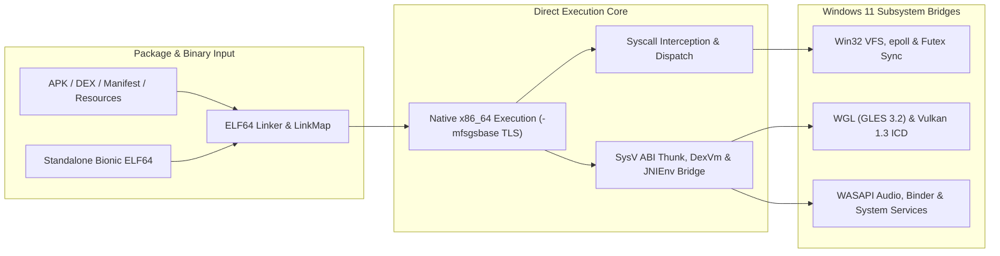

# Portage


A native user-mode Android compatibility layer for Windows 11 built in modern C++20 for systems engineers and runtime contributors.
Portage executes unmodified Android x86_64 Bionic ELF binaries and APK packages directly on the host CPU using `-mfsgsbase` TLS switching, explicit `sysv_abi` bridging, and Win32 subsystem passthrough without full-system emulation or a virtual machine.

---

## Why Portage?

- **Direct CPU Execution**: Guest 64-bit machine code runs natively in Windows user mode with fast thread-local storage via `rdfsbase` / `wrfsbase` instructions.
- **Custom Dynamic Linker**: Loads ELF64 binaries and recursive `DT_NEEDED` graphs with GNU/SysV hashing, `R_X86_64_TLSDESC` (`gnu2`), lazy `DT_JMPREL` PLT trampolines, `android_dlopen_ext`, `dlinfo`, and `dlclose` segment unmapping.
- **SysV to Win64 ABI Boundary & Dalvik DEX Runtime**: Bridges Android Bionic `libc`/`libdl`, NDK entry points (`ALooper`, `ANativeActivity`, `ANativeWindow_fromSurface`, `AAssetManager`, `AHardwareBuffer`, `Binder`), and a register-based Dalvik `.dex` bytecode VM (`DexVm` with D8 `invoke-custom`/`invoke-polymorphic`, `JavaRuntime` core libraries with UTF-16 `String`, `java.util` collections, `std::thread`-backed monitors/concurrency, `LambdaMetafactory`/`StringConcatFactory`, reflection, `java.nio.ByteBuffer`/`Charset`, VFS-routed `java.io`, and `java.util.regex`, `JavaActivityRunner`, `System.loadLibrary`) with bidirectional `__attribute__((sysv_abi))` `JavaVM`/`JNIEnv` dispatch.
- **Native GPU & Media Passthrough**: Translates OpenGL ES 2.0–3.2 (over WGL) and Vulkan 1.0–1.3 ICD calls with `SyncFence` file descriptors, alongside WASAPI AAudio/OpenSL ES and Media Foundation pipelines.

---

## Architecture Comparison

| Capability | Portage | Android Emulator / AVD | Full-System VM (Hyper-V) |
| :--- | :--- | :--- | :--- |
| **Execution Model** | Native Win32 user-mode process | Hypervisor + Linux guest kernel | Hypervisor + full OS image |
| **VM / Hyper-V Required** | None | Yes (WHPX / AEHD) | Yes |
| **Guest Binary ABI** | Android x86_64 ELF / APK | x86_64 or ARM64 translation | x86_64 |
| **Graphics Path** | Direct host WGL & Vulkan ICD | VirGL / gfxstream over IPC | VirtIO / vGPU paravirtualization |
| **ABI Translation** | Compiler-enforced `sysv_abi` thunks | Guest kernel syscall trap | Guest kernel syscall trap |
| **Process Startup** | Single `portage.exe` process | Cold OS boot or snapshot | Cold OS boot |

---

## Quickstart

> [!IMPORTANT]
> Portage requires Windows 11 on x86_64 with `FSGSBASE` support, Clang/Clang++, Ninja, CMake 3.25+, MSYS2 UCRT64 (`zlib`, `gtest`), and the Vulkan SDK. Guest binaries must target Android `x86_64`; ARM/ARM64 instruction translation is not supported.

### 1. Configure & Build

```powershell
cmake --preset debug
cmake --build build/debug
```

### 2. Run the Sample Native Activity APK

```powershell
.\build\debug\src\portage.exe --headless run build\debug\game_engine.apk
```

Expected output:

```text
[I/PortageEngine] ANativeActivity_onCreate started
[I/PortageEngine] AConfiguration orientation=2
[I/PortageEngine] ANativeActivity_onCreate finished
[I/PortageEngine] onStart
[I/PortageEngine] onResume
[I/PortageEngine] onNativeWindowCreated
[I/PortageEngine] onInputQueueCreated
[I/PortageEngine] onWindowFocusChanged hasFocus=1
[I/PortageEngine] onPause
[I/PortageEngine] onNativeWindowDestroyed
[I/PortageEngine] onInputQueueDestroyed
[I/PortageEngine] onStop
[I/PortageEngine] onDestroy
[I/PortageEngine] Worker thread started and ALooper prepared
[I/PortageEngine] Worker received cmd=1
[I/PortageEngine] Worker received cmd=6
[I/PortageEngine] Worker received cmd=15
[I/PortageEngine] Worker thread terminating
[portage] APK native activity execution completed successfully
```

<details>
<summary><strong>Run CTest verification or set up an NDK rootfs</strong></summary>

Run the full unit and integration suite (`555` tests — `518` unit, `37` integration):

```powershell
ctest --test-dir build/debug --output-on-failure
```

For standalone binary execution, populate `rootfs/` with NDK libraries using [setup_android_rootfs.py](.github/scripts/setup_android_rootfs.py). See [Get started with Portage](docs/getting-started.md) and [Verify and test Portage](docs/testing.md).

</details>

---

## Architecture



### Repository Layout

```text
portage/
├── .github/scripts/         # Rootfs provisioning script for NDK sysroot libraries
├── cmake/                   # Compiler warning presets and dependency discovery
├── rootfs/                  # Default guest Android root filesystem mount point
├── src/
│   ├── arch/                # Guest CPU context, stack layout, and FS/GS state
│   ├── elf/                 # ELF64 loader, TLSDESC, lazy PLT, and LinkMap runtime
│   ├── gles/ & vulkan/      # Hardware-accelerated OpenGL ES and Vulkan bridges
│   ├── ndk/ & package/      # NDK thunks, ALooper, APK/DEX parser, DexVm, JavaRuntime intrinsics, JavaActivityRunner, NativeActivity
│   ├── syscall/ & rewrite/  # Syscall rewriting, Linux syscall table, and dispatch
│   ├── launcher/            # portage.exe CLI entry point
│   └── ...                  # 29 modular Windows-bridged runtime subsystems
├── tests/
│   ├── guests/              # Cross-compiled Android x86_64 ELF & stub .so fixtures
│   ├── unit/                # GoogleTest subsystem suites
│   └── integration/         # End-to-end guest binary and APK runtime tests
├── tools/                   # Test APK sample generator (assemble_samples.cpp)
├── AGENTS.md                # Contributor architecture and ABI invariants
├── CMakeLists.txt           # Top-level C++20 CMake build configuration
└── CMakePresets.json        # Debug and Release Clang/Ninja presets
```

---

## Documentation

- [Get started with Portage](docs/getting-started.md): Toolchain prerequisites, Release/Debug CMake builds, rootfs provisioning, and running your first APK or ELF binary.
- [Architecture overview](docs/architecture.md): Direct execution model, `R_X86_64_TLSDESC` and lazy PLT dynamic linking, `-mfsgsbase` threading, and GPU `SyncFence` bridging.
- [ABI boundary and subsystem reference](docs/abi-and-subsystems.md): `sysv_abi` thunk conventions, `NdkSymbolRegistry` precedence, Bionic ABI parity, and the 29 `src/` subsystems.
- [CLI reference](docs/cli-reference.md): `portage.exe` subcommands, runtime flags, host environment variables, and default guest environment.
- [Verify and test Portage](docs/testing.md): 5-gate verification workflow, cross-compiling guest fixtures, and assembling sample APKs with `assemble_samples`.

---

## Contributing

Contributor rules and ABI invariants are also summarized in [AGENTS.md](AGENTS.md).
