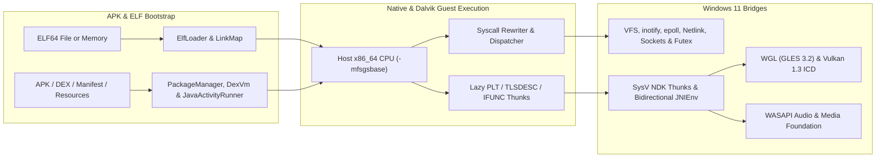
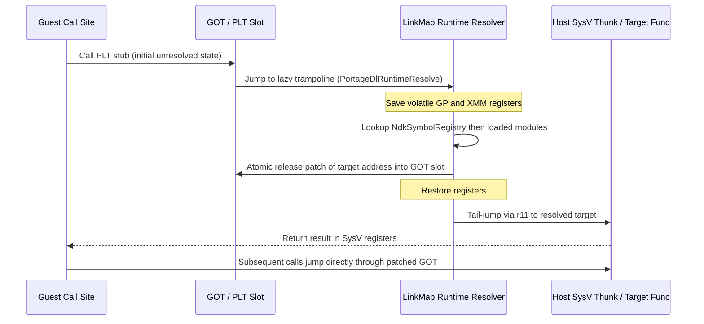

# Architecture overview

Portage runs unmodified Android `x86_64` Bionic binaries, native-activity APKs, and Dalvik `.dex` / hybrid Java-native APKs directly in a native Windows 11 user-mode process.
This document explains direct CPU execution, Dalvik bytecode interpretation, dynamic linking, syscall translation, and Win32 subsystem bridging.

## Runtime execution model

Unlike full-system Android emulators that boot a Linux kernel inside a hypervisor, Portage maps guest ELF segments directly into the host process virtual address space via [`AddressSpace`](../src/mem/address_space.hpp) and executes guest instructions natively on the host CPU.

## Dynamic linking, TLSDESC, and lazy PLT

[`ElfLoader`](../src/elf/elf_loader.hpp) parses ELF64 program headers (`PT_LOAD`, `PT_DYNAMIC`, `PT_TLS`, `PT_GNU_RELRO`), maps memory segments with page-aligned Win32 permissions, applies `DT_GNU_HASH` / `DT_HASH` symbol lookups with ELF symbol versioning (`DT_VERNEED` / `DT_VERSYM`) and `R_X86_64_IRELATIVE` IFUNC resolution, and registers modules in [`LinkMap`](../src/elf/link_map.hpp).

Key dynamic linker mechanisms:

- **Hybrid GNU2 TLSDESC (`R_X86_64_TLSDESC`)**: Modules without dynamic `PT_TLS` state bind `tlsdesc::entry` to `_dl_tlsdesc_return` (`mov rax, [rax + 8]; ret`), returning direct TP-relative offsets in 5 machine bytes. Dynamically loaded modules with `PT_TLS` bind to `_dl_tlsdesc_dynamic`, preserving caller-saved registers while computing `LinkMap::GetTlsAddress(...) - _readfsbase_u64()`.
- **Lazy `DT_JMPREL` binding**: Unless `RTLD_NOW`, `DF_BIND_NOW`, or `DF_1_NOW` forces eager resolution, `R_X86_64_JUMP_SLOT` entries receive per-slot executable trampolines allocated in RWX trampoline pools, resolving once on first call.
- **Extended Bionic loading (`android_dlopen_ext`, `dlinfo`, `dlclose`)**: Supports loading shared libraries directly from guest file descriptors and offsets (`ANDROID_DLEXT_USE_LIBRARY_FD`, `ANDROID_DLEXT_USE_LIBRARY_FD_OFFSET`, `ANDROID_DLEXT_RESERVED_ADDRESS`), metadata queries via `dlinfo` (`RTLD_DI_*`), reference-counted teardown with `DT_FINI`/`__cxa_atexit`, and segment unmapping via `AddressSpace::Munmap` when `RTLD_NODELETE` is absent.

## Threading, TLS, and signal recovery

Because Windows x64 reserves `%gs` for the Win32 Thread Environment Block (TEB), guest Bionic code uses `%fs` (`rdfsbase` / `wrfsbase`) for its Thread Control Block (TCB) and per-thread TLS slots:

- [`ThreadManager`](../src/thread/thread_manager.hpp) tracks active guest threads, thread names (`/proc/self/task/<tid>/comm` and `pthread_setname_np`), TCB pointers (`arch_prctl` `ARCH_SET_FS`), and guest stack bounds.
- [`GuestContext`](../src/arch/guest_context.hpp) isolates guest execution frames cleanly across host-to-guest entries and `clone` worker threads.
- [`SignalManager`](../src/signal/signal_manager.hpp) installs a Windows Vectored Exception Handler (VEH) to translate hardware access violations into guest `SIGSEGV` delivery with alternate signal stacks (`sigaltstack`).

## Syscalls, VFS, and GPU synchronization

Linux `x86_64` `syscall` instructions are rewritten by [`SyscallRewriter`](../src/rewrite/syscall_rewriter.hpp) or routed through [`SyscallDispatcher`](../src/syscall/syscall_dispatcher.hpp):

- **Filesystem, Networking & Process Inspection**: [`Vfs`](../src/fs/vfs.hpp) maps guest paths onto configurable host rootfs directories and mount points, synthesizing `/proc` (`maps`, `self/{smaps,smaps_rollup,status}`, `stat`, `comm`, `auxv`, `fd`, `task`), `/sys` (cgroups v2, CPU topology), `/dev`, `/dev/__properties__`, `inotify` watches, and Netlink route sockets (`AF_NETLINK`, `NETLINK_ROUTE`).
- **Unified `SyncFence` Polling**: Both Vulkan external sync FDs (`VK_KHR_external_fence_fd`, `VK_KHR_external_semaphore_fd`) and EGL native fence syncs (`EGL_ANDROID_native_fence_sync`) wrap `SyncFenceState` in [`FileDescriptorTable`](../src/fs/fd_table.hpp), allowing guest `epoll`, `poll`, and `select` loops to wait directly on GPU completion events.
- **Graphics Presentation**: [`WglBridge`](../src/gles/wgl_bridge.hpp) and [`VulkanBridge`](../src/vulkan/vulkan_bridge.hpp) pass OpenGL ES 2.0–3.2 and Vulkan 1.0–1.3 calls directly to host ICDs, translating `AHardwareBuffer` imports (`VkImportAndroidHardwareBufferInfoANDROID` and `glEGLImageTargetTexture2DOES`) and presenting frames to Win32 `HWND` surfaces managed by [`WindowManager`](../src/wsi/window_manager.hpp).

For ABI calling-convention rules and the complete subsystem directory map, see [ABI and subsystem guide](./abi-and-subsystems.md).
